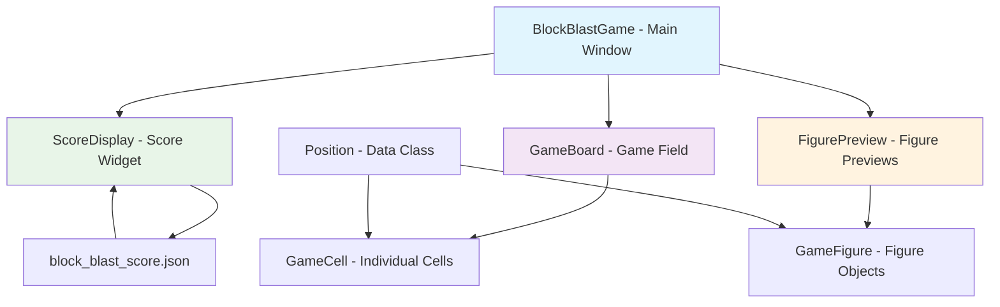
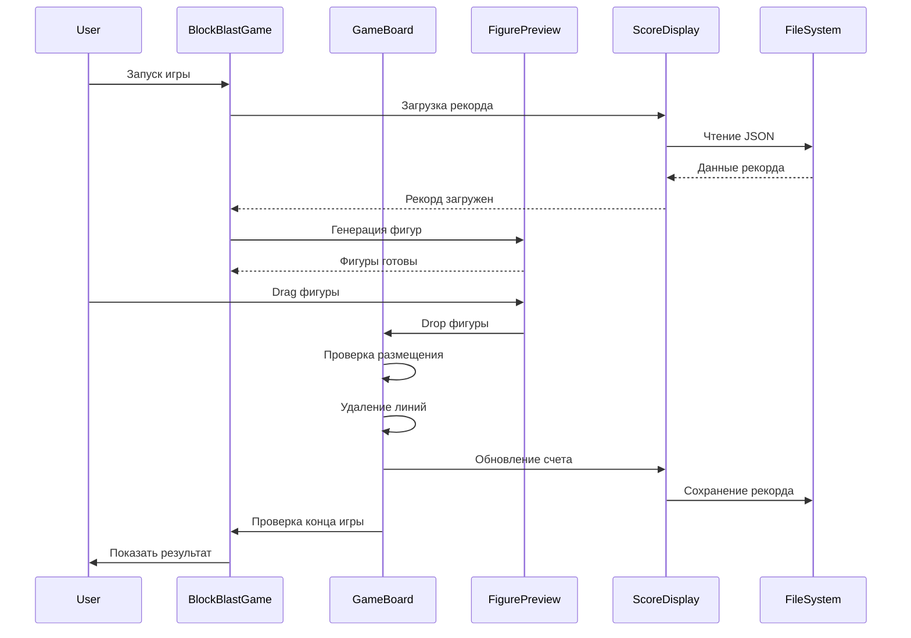

# Block Blast - Документация проекта

## 📋 Содержание
1. [Структура проекта](#-структура-проекта)
2. [Описание файлов](#-описание-файлов)
3. [Архитектура проекта](#-архитектура-проекта)
4. [Библиотеки/фреймворки](#-библиотекифреймворки)
5. [Точка входа и запуск](#-точка-входа-и-запуск)
6. [Архитектурные особенности](#-архитектурные-особенности)

---

## 🗂️ Структура проекта

### Дерево файлов и папок
```
1/
├── BlockBlast.py              # Основной файл игры
├── block_blast_score.json     # Файл сохранения рекордов
└── README.md                  # Документация проекта
```

---

## 📄 Описание файлов

### BlockBlast.py
**Назначение:** Основной файл игры, содержащий всю логику и интерфейс

**Ключевые классы:**
- `Position` - Датакласс для представления позиции на поле
- `GameFigure` - Класс игровой фигуры (полиомино)
- `GameCell` - Отдельная клетка игрового поля
- `FigurePreview` - Виджет предварительного просмотра фигуры
- `GameBoard` - Главное игровое поле
- `ScoreDisplay` - Виджет отображения счета
- `BlockBlastGame` - Основное окно игры

**Связи с другими файлами:**
- Читает/записывает `block_blast_score.json` для сохранения рекордов
- Использует системные библиотеки Python и PyQt6

**Логика работы:**
1. Инициализация игрового поля 9x9
2. Генерация случайных фигур (полиомино)
3. Drag & Drop размещение фигур
4. Проверка и удаление полных линий
5. Подсчет очков и сохранение рекордов

### block_blast_score.json
**Назначение:** Файл для сохранения рекордов игры

**Структура:**
```json
{
  "high_score": 1050
}
```

**Связи:** Используется классом `ScoreDisplay` для загрузки/сохранения рекордов

---

## 🏗️ Архитектура проекта

### Общая структура
Проект построен по принципу Model-View-Controller (MVC) с использованием PyQt6:



### Потоки данных



---

## 📚 Библиотеки/фреймворки

### PyQt6
**Назначение:** Основной GUI фреймворк для создания интерфейса
**Где используется:**
- `QApplication` - Основное приложение
- `QMainWindow` - Главное окно игры
- `QWidget` - Базовые виджеты (GameCell, FigurePreview, GameBoard)
- `QLabel` - Отображение счета
- `QPushButton` - Кнопки управления
- `QPainter` - Отрисовка графики
- `QTimer` - Анимации и задержки
- `QDrag`, `QMimeData` - Drag & Drop функциональность

### Стандартные библиотеки Python
**Назначение:** Базовая функциональность
**Где используются:**
- `sys` - Системные функции, выход из приложения
- `json` - Сохранение/загрузка рекордов
- `random` - Генерация случайных фигур
- `math` - Математические операции
- `typing` - Аннотации типов
- `dataclasses` - Создание класса Position
- `pathlib` - Работа с путями файлов

---

## 🚀 Точка входа и запуск

### Как запускается проект
1. **Точка входа:** Функция `main()` в конце файла `BlockBlast.py`
2. **Инициализация:** Создание QApplication и установка темной темы
3. **Создание игры:** Инициализация главного окна `BlockBlastGame`
4. **Запуск цикла:** Выполнение `app.exec()`

### Что выполняется первым
```python
def main():
    app = QApplication(sys.argv)           # Создание приложения
    app.setApplicationName("Block Blast")  # Установка имени
    app.setStyle('Fusion')                 # Установка стиля
    # Настройка темной палитры
    game = BlockBlastGame()                # Создание игры
    game.show()                            # Показ окна
    sys.exit(app.exec())                   # Запуск цикла событий
```

## 🎯 Архитектурные особенности

### Нестандартные решения

#### 1. Система Drag & Drop для фигур
- **Решение:** Использование QDrag и QMimeData для перетаскивания фигур
- **Причина:** Интуитивный интерфейс, соответствующий современным стандартам UX
- **Реализация:** Создание pixmap фигуры для визуального отображения при перетаскивании

#### 2. Предварительный просмотр размещения
- **Решение:** Подсветка клеток при наведении курсора
- **Причина:** Улучшение пользовательского опыта, предотвращение ошибок
- **Реализация:** Система highlight в GameCell с анимацией

#### 3. Модульная архитектура виджетов
- **Решение:** Каждый компонент - отдельный класс с четкими обязанностями
- **Причина:** Легкость поддержки, тестирования и расширения
- **Реализация:** Разделение на GameCell, FigurePreview, GameBoard, ScoreDisplay

#### 4. Система сигналов и слотов
- **Решение:** Использование pyqtSignal для связи между компонентами
- **Причина:** Слабая связанность компонентов, реактивность
- **Реализация:** Сигналы figure_placed, lines_cleared, game_over

### Причины выбора архитектуры

#### 1. PyQt6 как GUI фреймворк
- **Преимущества:** Кроссплатформенность, богатая функциональность, производительность
- **Альтернативы:** Tkinter (ограниченная функциональность), Kivy (избыточность для 2D)

#### 2. Объектно-ориентированный подход
- **Преимущества:** Четкое разделение ответственности, переиспользование кода
- **Реализация:** Каждый игровой элемент - отдельный класс

#### 3. Система событий
- **Преимущества:** Асинхронность, отзывчивость интерфейса
- **Реализация:** QTimer для анимаций, сигналы для связи компонентов

#### 4. Сохранение состояния
- **Преимущества:** Персистентность данных между сессиями
- **Реализация:** JSON файл для простоты и читаемости

### Производительность и оптимизация

#### 1. Эффективная отрисовка
- Использование QPainter с антиалиасингом
- Градиенты для визуального эффекта
- Оптимизированные размеры виджетов

#### 2. Умная проверка размещения
- Проверка границ поля
- Проверка занятости клеток
- Кэширование результатов проверок

#### 3. Анимации
- Использование QTimer для плавных переходов
- Минимальные задержки для отзывчивости
- Оптимизированные анимации удаления линий

---

## 🎮 Игровая механика

### Правила игры
1. **Цель:** Размещать фигуры на поле 9x9
2. **Фигуры:** Полиомино различной формы (от 1 до 9 блоков)
3. **Размещение:** Drag & Drop или клик мышью
4. **Удаление линий:** Полные строки и столбцы исчезают
5. **Очки:** 100 очков за линию + бонус за множественное удаление
6. **Конец игры:** Невозможность разместить ни одной фигуры

### Система очков
- **Базовая линия:** 100 очков
- **Множественное удаление:** +50 очков за каждую дополнительную линию
- **Рекорды:** Автоматическое сохранение лучшего результата

### Типы фигур
- **Линейные:** 2-5 блоков в ряд (горизонтально/вертикально)
- **Квадратные:** 2x2, 3x3
- **L-образные:** 4 блока в форме L
- **T-образные:** 4 блока в форме T
- **Z-образные:** 4 блока в форме Z
- **Угловые:** 3-5 блоков в форме угла

---

## 🔧 Установка и запуск

### Требования
- Python 3.7+
- PyQt6

### Установка зависимостей
```bash
pip install PyQt6
```

### Запуск игры
```bash
python BlockBlast.py
```

### Сборка исполняемого файла (опционально)
```bash
pip install pyinstaller
pyinstaller --onefile --windowed BlockBlast.py
```

---

## 📝 Заключение

Проект Block Blast представляет собой полнофункциональную реализацию популярной головоломки с современным интерфейсом и продуманной архитектурой. Использование PyQt6 обеспечивает кроссплатформенность и богатую функциональность, а модульная структура кода делает проект легко расширяемым и поддерживаемым.

Ключевые особенности:
- ✅ Интуитивный Drag & Drop интерфейс
- ✅ Предварительный просмотр размещения
- ✅ Система сохранения рекордов
- ✅ Анимации и визуальные эффекты
- ✅ Модульная архитектура
- ✅ Кроссплатформенность
- ✅ Полная документация

Подпись относится к текущей версии проекта.

---

Автор: legenda  
Telegram: [@LEGENDA_SD](https://t.me/LEGENDA_SD)
